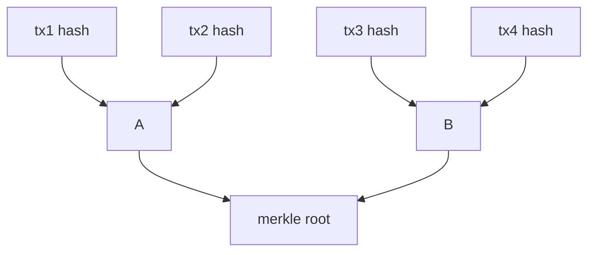

## Hook: The Tampered Update {data-sync-unmatched="true"}

- You download a “critical security update.”
- It says the checksum matches—so you install it.
- Ten minutes later, your wallet is drained.

::: {.notes}
Key Points:
* Integrity checks prevent silent tampering.
* Hashes and symmetric crypto are real-world safety rails.
* If integrity or randomness fails, adversaries win fast.

Instructor Notes and Script:
Open with a concrete story: a user downloads a signed update that also shows a matching checksum. In a real incident, when checksums or signatures were misapplied or misunderstood, attackers slipped in modified binaries. Explain that cryptographic hashes authenticate integrity, and symmetric encryption protects confidentiality and performance. These tools are widely deployed in operating systems, software distribution, backups, and blockchains.
Bridge to blockchain: blocks are chained by hashes; transactions are protected by cryptography. If a single bit changes, strong hashes explode the output, revealing tampering. The lecture shows how symmetric ciphers, modes, and hash functions work and how they underpin Merkle trees and blockchain verification.
Use relatable language: students have all seen “SHA‑256 checksum” on downloads. Make the emotional connection—losing funds is a visceral fear—and then explain how correct cryptographic use mitigates it.

Script:
"Imagine you install a critical update. The site shows ‘checksum OK.’ But the file was swapped and the checksum wasn’t actually verified with a trustworthy hash. Ten minutes later your wallet is empty. Today we learn the tools that stop that: modern symmetric ciphers and robust hash functions."

References:
- [Secure Hash Standard (FIPS 180-4)](https://csrc.nist.gov/publications/detail/fips/180/4/final)
- [Advanced Encryption Standard (FIPS 197)](https://csrc.nist.gov/publications/detail/fips/197/final)
:::

## Roadmap {data-sync-unmatched="true"}

- Symmetric vs asymmetric: focus for today
- Block ciphers (AES) and modes (ECB, CBC, CTR, GCM)
- Stream ciphers and PRGs (why RC4 is deprecated)
- Hash functions (SHA‑2/SHA‑3) and collision resistance
- Merkle trees and blockchain integrity

::: {.notes}
Key Points:
* Set expectations and sequence.
* Emphasize “why” before “how.”

Instructor Notes and Script:
Preview today’s arc: we will distinguish symmetric from asymmetric cryptography, then go deeper on block ciphers and their modes. We will cover stream ciphers and pseudorandom generators to explain why keystream reuse is dangerous and why RC4 fell out of favor. Then we’ll study cryptographic hash functions and end with Merkle trees, the compact integrity structure used inside blocks.
Keep reminding students how each concept maps to blockchain: AES and modes illustrate confidentiality patterns; hashes provide tamper evidence; Merkle roots summarize all transactions concisely.

Script:
"Here’s our plan: start with the big picture, drill into the core tools, and tie each one to what blockchains actually do."

References:
- [Introduction to Modern Cryptography (lecture notes on PRGs/PRFs)](https://intensecrypto.org/public/lec_05_prf-from-prg.html)
:::

## Symmetric vs Asymmetric (Big Picture) {data-sync-id="signatures-symmetric-asymmetric"}

- Symmetric: one secret key for encrypt/decrypt (fast, at scale).
- Asymmetric: public key verify / private key sign (slower, for auth).
- In practice: use symmetric for data, asymmetric to exchange keys.

::: {.notes}
Key Points:
* Symmetric is the workhorse for bulk data.
* Asymmetric bootstraps trust and signatures.

Instructor Notes and Script:
Define symmetric cryptography simply: the same secret key protects and reveals the message. It offers high performance, which is why it’s used for data at rest, VPNs, and TLS record protection after a handshake. Asymmetric cryptography uses key pairs and is ideal for authentication, signatures, and key establishment, but is slower. Real systems combine them: an asymmetric handshake sets up symmetric session keys.
Connect to blockchain: digital signatures (asymmetric) prove authorization, while symmetric primitives and hashes appear in wallets, protocols, and supporting systems.

Script:
"Think of symmetric crypto like a fast, strong door lock you and your friend share. Asymmetric crypto is like a mailbox: anyone can put mail in with your public key, but only you can open with your private key."

References:
- [Protocols for Public Key Cryptosystems (Diffie–Hellman & Merkle, 1976)](https://nakamotoinstitute.org/library/public-key-cryptosystems/)
- [FIPS 197 (AES)](https://csrc.nist.gov/publications/detail/fips/197/final)
:::

## Block Ciphers as Pseudorandom Permutations {data-sync-unmatched="true"}

- A block cipher is a keyed permutation on fixed-size blocks.
- With the key hidden, it should look random (PRP/PRF intuition).
- AES is the de facto modern standard.

::: {.notes}
Key Points:
* Understand “keyed permutation” intuition.
* AES is the standard example of a secure block cipher.

Instructor Notes and Script:
Describe a block cipher as a function that takes a fixed-size block (128 bits for AES) and a secret key to produce a ciphertext block, and is invertible with the same key. Security goal: to any efficient observer without the key, the mapping should be indistinguishable from a random permutation. That intuition underlies formal PRP/PRF security notions taught in foundational courses.
AES won the NIST competition and replaced earlier ciphers like DES/3DES. We will not derive AES internals, but note SubBytes, ShiftRows, MixColumns, and AddRoundKey transformations.

Script:
"AES takes 128-bit chunks and jumbles them so well that, without the key, it looks like pure randomness. With the key, you can reverse it exactly."

References:
- [FIPS 197: Advanced Encryption Standard (AES)](https://csrc.nist.gov/publications/detail/fips/197/final)
- [PRF from PRG (course note for background intuition)](https://intensecrypto.org/public/lec_05_prf-from-prg.html)
:::

## Inside AES (High Level) {data-sync-unmatched="true"}

- Block size: 128 bits; keys: 128/192/256 bits.
- Round structure with S-boxes and linear mixing.
- Wide adoption in SSL/TLS, disk encryption, VPNs.

::: {.notes}
Key Points:
* AES parameters and round idea.
* Ubiquity across protocols and products.

Instructor Notes and Script:
List AES parameters precisely: 128-bit block size; keys of 128, 192, or 256 bits; 10/12/14 rounds respectively. Explain that each round substitutes bytes via an S-box, permutes rows, mixes columns, and adds round key material. Stress why AES is everywhere: standardized by NIST, hardware acceleration (AES-NI) on CPUs, and extensively analyzed for decades.
Clarify that using AES safely requires a “mode of operation,” covered next.

Script:
"AES isn’t a whole system by itself. It’s a powerful engine. We need a safe transmission system—a mode—to use it correctly."

References:
- [FIPS 197](https://csrc.nist.gov/publications/detail/fips/197/final)
:::

## Modes of Operation (ECB, CBC, CTR, GCM) {data-sync-unmatched="true"}

::: {.column width="50%"}
- ECB: identical blocks leak patterns—do not use for confidential data.
- CBC: random IV; chaining hides patterns; needs padding and integrity.
- CTR: turns block cipher into a stream; nonce misuse is catastrophic.
- GCM: authenticated encryption with associated data (AEAD).
:::

::: {.column width="50%"}
```mermaid
flowchart TB
A[Plain Blocks] -->|ECB| E[Pattern Leaks]
A -->|CBC + IV| C[Chained Ciphertext]
A -->|CTR + Nonce| S[Keystream XOR]
C -->|add MAC| M[Integrity]
S -->|AEAD (GCM)| G[Encrypt + Auth]
```
:::

::: {.notes}
Key Points:
* ECB leaks structure; avoid it for secrecy.
* CBC, CTR, and GCM are standard; nonces/IVs matter.
* AEAD (e.g., GCM) provides confidentiality + integrity.

Instructor Notes and Script:
Explain that modes define how to apply a block cipher to longer messages. ECB encrypts each block independently; identical inputs yield identical outputs and reveal patterns. NIST guidance warns against ECB for confidentiality. CBC uses a random IV and chains blocks, but requires padding and a separate integrity check if not using AEAD. CTR mode generates a keystream from a counter and nonce; reuse of a nonce with the same key reveals keystream and breaks security. GCM provides AEAD—ensuring both confidentiality and integrity in one construction—using a nonce and polynomial MAC over GF(2^128).
Emphasize operational rules: choose random or unique nonces as required, never reuse, and authenticate your ciphertexts.

Script:
"ECB is like wrapping gifts in clear cellophane—everyone sees the shape. CBC is opaque wrapping with a new randomized start each time. CTR is a numbered roll of tape; if you reuse the number, attackers peel messages apart. GCM gives you both secrecy and tamper detection."

References:
- [NIST SP 800-38A: Recommendation for Block Cipher Modes of Operation](https://csrc.nist.gov/publications/detail/sp/800-38a/final)
- [NIST SP 800-38D: Galois/Counter Mode (GCM) and GMAC](https://csrc.nist.gov/publications/detail/sp/800-38d/final)
:::

## Stream Ciphers and PRGs {data-sync-unmatched="true"}

- PRG stretches a short seed into a long pseudorandom keystream.
- Stream ciphers encrypt by XORing keystream with plaintext.
- RC4 is deprecated due to biases and attacks.

::: {.notes}
Key Points:
* Understand PRG → keystream → XOR encryption.
* RC4 weaknesses drove protocol-level deprecation.

Instructor Notes and Script:
Define a PRG: a deterministic function that outputs longer sequences indistinguishable from random given a short seed. Stream ciphers build on PRGs: generate keystream and XOR with plaintext. Stress that keystream reuse (same seed/nonce) reveals XOR of messages. RC4, once commonly used, showed significant biases enabling attacks; the IETF formally prohibited RC4 in TLS due to practical vulnerabilities.
Operational takeaway: prefer modern AEAD modes (e.g., AES‑GCM, ChaCha20‑Poly1305).

Script:
"A stream cipher is like a very long pad of random bits. You XOR one page with your message. If you reuse the same page, someone can subtract your secrets right out."

References:
- [IETF RFC 7465: Prohibiting RC4 Cipher Suites](https://datatracker.ietf.org/doc/html/rfc7465)
- [Fluhrer–Mantin–Shamir Attack on RC4 (2001)](https://link.springer.com/chapter/10.1007/3-540-45537-X_1)
- [PRG background](https://intensecrypto.org/public/lec_03_pseudorandom-generators.html#stream-ciphers)
:::

## Hash Functions (Definition & Properties) {data-sync-id="hashing-definition hashing-properties hashing-preimage hashing-second-preimage hashing-collision hashing-avalanche"}

- Map any-length input to fixed-length digest.
- Preimage, second-preimage, and collision resistance.
- Avalanche effect: tiny input change → large output change.

::: {.notes}
Key Points:
* Formal properties matter for security claims.
* Hashes are not encryption; they are one-way fingerprints.

Instructor Notes and Script:
Define cryptographic hash functions and the three core hardness properties. Clarify the distinction from checksums and from encryption. Emphasize determinism and the avalanche effect as a sanity property, not a formal guarantee. Introduce SHA‑2 family (SHA‑256/384/512) and SHA‑3 (Keccak) as current NIST standards. These are the primitives behind block headers and Merkle roots.
Tie to integrity workflows: package managers, software updates, and blockchain validation.

Script:
"Think of a hash like a digital fingerprint: easy to compute, nearly impossible to reverse, and a single scratch changes the fingerprint completely."

References:
- [FIPS 180-4: Secure Hash Standard (SHA‑2)](https://csrc.nist.gov/publications/detail/fips/180/4/final)
- [FIPS 202: SHA‑3 Standard (Keccak)](https://csrc.nist.gov/publications/detail/fips/202/final)
:::

## When Hashes Fail: SHA‑1 Collisions {data-sync-id="hashing-sha-family hashing-collision"}

- SHA‑1 is no longer collision resistant at 80-bit security.
- 2017 “SHAttered” produced two PDFs with same SHA‑1.
- NIST recommends moving away from SHA‑1.

::: {.notes}
Key Points:
* Real-world collision was demonstrated for SHA‑1.
* Migrate to SHA‑2 or SHA‑3 for collision resistance.

Instructor Notes and Script:
Explain that SHA‑1, published in 1995, provided roughly 80‑bit collision security; advances in cryptanalysis and compute made collisions feasible. In 2017, researchers generated two distinct PDFs with the same SHA‑1 digest (SHAttered). NIST guidance deprecates SHA‑1 for digital signatures and collision‑resistant applications. Stress that blockchains use SHA‑256 (Bitcoin) or KECCAK variants (Ethereum), not SHA‑1, for precisely this reason.
Show a screenshot or link to the collision demo to make it concrete.

Script:
"Two different files with the exact same SHA‑1 hash exist. That breaks the promise we rely on. The fix is simple: use SHA‑256 or SHA‑3."

References:
- [SHAttered (Google & CWI Amsterdam, 2017)](https://shattered.io)
- [NIST Guidance on SHA‑1 Transition (CSRC notices)](https://csrc.nist.gov/projects/hash-functions/sha-1-transition)
:::

## Merkle Trees (Integrity at Scale) {data-sync-id="hashing-merkle-definition hashing-merkle-building hashing-merkle-example"}

::: {.column width="50%"}
- Leaves: transaction hashes.
- Parents: hash(children).
- Root commits to all leaves.
:::

::: {.column width="50%"}

:::

::: {.notes}
Key Points:
* Merkle root summarizes many items compactly.
* Log-size proofs enable light clients (SPV).

Instructor Notes and Script:
Define the structure formally and connect to inclusion proofs: to show tx2 is in the block, send tx2 and sibling hashes up the path so the verifier recomputes the root. This scales: proof size grows logarithmically with the number of leaves. Mention Merkle’s original patent/paper as the first description of tree-based authentication of large data sets, later adopted widely in distributed systems and blockchains.

Script:
"A Merkle tree is a compact receipt for a whole basket of transactions. To prove one item is inside, you show a short path of hashes up to the root."

References:
- [Method of Providing Digital Signatures (Merkle, 1979/1980)](https://patents.google.com/patent/US4309569A/en)
- [Hash Functions, Part 2 (Merkle trees and verifying storage)](https://intensecrypto.org/public/lec_08_hash_functions_part2.html#merkle-trees-and-verifying-storage)
:::

## How Hashes Anchor Blocks {data-sync-id="hashing-merkle-applications hashing-tamper-evidence"}

- Block headers include previous block hash and Merkle root.
- Any change cascades through subsequent hashes.
- Immutability arises from hash chaining + consensus.

::: {.notes}
Key Points:
* Hash pointers create tamper-evident chains.
* Small edits force recomputation of all later blocks.

Instructor Notes and Script:
Describe the block header fields relevant to integrity: previous block hash and Merkle root bind the structure. If an adversary alters a transaction, the Merkle root changes, which changes the block header hash, which breaks the next block’s previous-hash pointer, and so on. Only by outpacing the network’s consensus could an attacker make the altered chain dominant.

Script:
"Hashes are like welded links. If you grind one link and reforge it, you must then reforge every link after, faster than everyone else."

References:
- [Bitcoin: A Peer-to-Peer Electronic Cash System](https://nakamotoinstitute.org/bitcoin/)
- [Hash Functions and the “Bitcoin problem”](https://intensecrypto.org/public/lec_07_hash_functions.html#the-bitcoin-problem)
:::

## Pitfalls: IV/Nonce Reuse and Poor Randomness {data-sync-unmatched="true"}

- Reusing a CTR/GCM nonce with same key breaks confidentiality/integrity.
- Predictable IVs/nonces leak keystream or enable forgery.
- Always use unique nonces and authenticated encryption.

::: {.notes}
Key Points:
* Nonce/IV misuse is a common, fatal error.
* AEAD modes with correct nonces mitigate many attacks.

Instructor Notes and Script:
Ground the warning in standards language: NIST 800‑38A and 38D specify requirements for IV/nonce selection and uniqueness. In CTR, reusing a nonce repeats the keystream. In GCM, nonce reuse can enable forgeries with catastrophic effect. Tie this to real operations: wallet software, P2P protocols, and APIs must treat nonces as single‑use numbers. Mention that random generation must be robust; if seeds are weak, attackers can predict nonces.

Script:
"A ‘nonce’ should mean ‘number used once.’ If you reuse it, you’re handing attackers a crowbar to pry open your messages."

References:
- [NIST SP 800-38A](https://csrc.nist.gov/publications/detail/sp/800-38a/final)
- [NIST SP 800-38D](https://csrc.nist.gov/publications/detail/sp/800-38d/final)
:::

## Mini Walkthrough: From Data to Block {data-sync-id="hashing-merkle-applications"}

- Hash transactions → build Merkle root.
- Place root and previous hash in header.
- Apply consensus rules to accept the block.

::: {.notes}
Key Points:
* Tie primitives together end-to-end.
* Show where symmetric/hash tools appear.

Instructor Notes and Script:
Narrate the pipeline: start with a set of transactions, compute their hashes, assemble the Merkle tree to obtain the root, construct a block header that also carries the previous block hash, then broadcast. Peers verify hashes and roots quickly. Symmetric crypto appears in securing channels and storage; hashes are central to tamper evidence.

Script:
"Let’s connect the dots: hashes build the tree, the root anchors the header, the header links to the last block, and the network checks it all in milliseconds."

References:
- [Bitcoin Whitepaper](https://nakamotoinstitute.org/bitcoin/)
:::

## Recap {data-sync-id="hashing-summary"}

- AES: secure block cipher; choose safe modes (CTR/GCM).
- Stream ciphers: PRG keystream XOR; never reuse nonces.
- Hashes: SHA‑2/SHA‑3 for integrity; avoid SHA‑1.
- Merkle trees: compact proofs for block inclusion.

::: {.notes}
Key Points:
* Consolidate the must-know rules.
* Emphasize operational guardrails.

Instructor Notes and Script:
Summarize concise rules of thumb students can remember. Reiterate the cost of mistakes like ECB use or nonce reuse. Highlight that these primitives are not abstract; they are implemented in libraries and hardware students will encounter in labs and careers.

Script:
"If you remember four things: AES with AEAD, no nonce reuse, SHA‑256 not SHA‑1, and Merkle roots summarize blocks."

References:
- [FIPS 197](https://csrc.nist.gov/publications/detail/fips/197/final)
- [FIPS 180-4](https://csrc.nist.gov/publications/detail/fips/180/4/final)
- [FIPS 202](https://csrc.nist.gov/publications/detail/fips/202/final)
- [NIST SP 800-38D](https://csrc.nist.gov/publications/detail/sp/800-38d/final)
:::

## Check on Learning {data-sync-unmatched="true"}

- Why is ECB unsafe for confidentiality?
- What goes wrong if a CTR/GCM nonce is reused?
- What properties make SHA‑256 suitable for blockchain integrity?
- How do Merkle proofs let light clients verify inclusion?

::: {.notes}
Key Points:
* Assess understanding of modes, nonces, hashes, and trees.
* Encourage students to explain in their own words.

Instructor Notes and Script:
Use these questions to probe depth of understanding and misconceptions. Ask students to sketch a simple Merkle proof path and to describe the difference between “checksum” and “cryptographic hash.” Tie back to the hook: what practices would have prevented the tampered update from succeeding?

Script:
"Turn to a partner and explain why repeating a nonce in CTR or GCM is dangerous. Then sketch how a Merkle proof works for a 4‑leaf tree."

References:
- [NIST SP 800-38A](https://csrc.nist.gov/publications/detail/sp/800-38a/final)
- [FIPS 180-4](https://csrc.nist.gov/publications/detail/fips/180/4/final)
- [Merkle Patent](https://patents.google.com/patent/US4309569A/en)
:::
