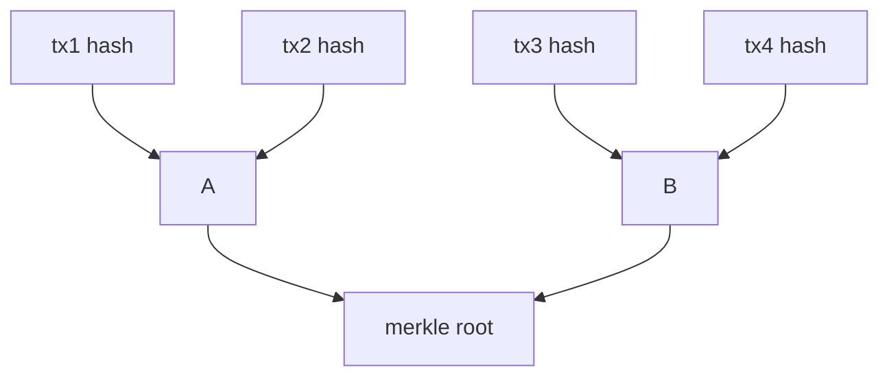

## Hook: The Fake Bank Statement {data-sync-unmatched="true"}

- You receive an emailed “bank statement.”  
- It looks official—but how do you *know* it hasn’t been changed?  
- Cryptographic integrity proofs answer this.

::: {.notes}
Key Points:
* Merkle trees and digital signatures prove authenticity.  
* Without them, tampering is undetectable.  
* Blockchain depends on these proofs for trust.  

Instructor Notes and Script:
Open with the scenario: a student receives a PDF of their “bank statement.” It has the logo, formatting, and numbers. But unless it is digitally signed or integrity-protected, they cannot be sure it is genuine. This highlights the motivation for hash-based integrity and public-key digital signatures.  
Introduce the theme: today’s lecture explores Merkle trees, hash properties, pseudorandomness, and signatures, showing how they solve this problem inside blockchain systems.  
Encourage the students to connect this idea with everyday trust: software updates, messaging apps, and banking all depend on these mechanisms.  

Script:  
"Imagine you get an email with a bank statement. How do you know it hasn’t been edited? We need tools that guarantee authenticity. That’s where hashes, Merkle trees, and digital signatures come in."  

References:  
- [Hash Functions (Intense Crypto)](https://intensecrypto.org/public/lec_07_hash_functions.html)  
- [Merkle Trees and Verifying Storage](https://intensecrypto.org/public/lec_08_hash_functions_part2.html#merkle-trees-and-verifying-storage)  
:::

## Roadmap {data-sync-unmatched="true"}

- Stream ciphers and pseudorandom generators  
- Cryptographic vs non-cryptographic hashes  
- Merkle trees and collision resistance  
- Digital signatures and verification in blockchain  

::: {.notes}
Key Points:
* Provide lecture roadmap.  
* Stress blockchain context for each concept.  

Instructor Notes and Script:
Frame the lecture. Start with pseudorandomness and stream ciphers, then explore properties of hash functions, move to Merkle trees, and end with digital signatures.  
Emphasize that these are not abstract ideas—they underpin blockchain’s ability to provide decentralized trust.  

Script:  
"Here’s our journey today: pseudorandomness and ciphers, then hashes, Merkle trees, and finally digital signatures. Each step shows us how blockchain resists tampering and forgery."  

References:  
- [PRF from PRG](https://intensecrypto.org/public/lec_05_prf-from-prg.html)  
:::

## Stream Ciphers and PRGs {data-sync-unmatched="true"}

- PRG: short random seed → long pseudorandom stream  
- Stream ciphers: keystream XOR plaintext  
- Example: RC4 (deprecated for biases)  

::: {.notes}
Key Points:
* PRGs stretch entropy.  
* Stream ciphers encrypt with XOR.  
* RC4 is insecure due to statistical flaws.  

Instructor Notes and Script:
Define pseudorandom generator (PRG). Stress that it takes a small truly random seed and outputs a long pseudorandom sequence. Stream ciphers encrypt by XORing the keystream with the plaintext.  
Explain that if the same keystream is reused, attackers can XOR ciphertexts to recover information. Highlight RC4’s history: once dominant, but shown biased and deprecated. Blockchain protocols avoid RC4, but PRGs remain central for nonce/seed generation.  

Script:  
"A PRG is like turning a short spark into a long flame of randomness. A stream cipher uses that flame to hide your message. But if you reuse the flame, attackers can see right through. RC4 failed because its flame flickered in predictable patterns."  

References:  
- [Pseudorandom Generators & Stream Ciphers](https://intensecrypto.org/public/lec_03_pseudorandom-generators.html#stream-ciphers)  
- [IETF RFC 7465 (RC4 Prohibition)](https://datatracker.ietf.org/doc/html/rfc7465)  
:::

## Cryptographic Hash Functions {data-sync-id="hashing-definition hashing-properties hashing-preimage hashing-second-preimage hashing-collision hashing-avalanche"}

- Input: any length → fixed-length digest  
- Properties: preimage, second-preimage, collision resistance  
- Avalanche effect: tiny change → huge output difference  

::: {.notes}
Key Points:
* Hashes are one-way functions.  
* Security depends on resistance properties.  
* Avalanche ensures tampering obvious.  

Instructor Notes and Script:
Define cryptographic hash functions. Show that they produce fixed-length digests regardless of input size. Discuss the three hardness properties. Clarify avalanche as intuitive property: small input change causes major output change.  
Contrast with non-cryptographic hashes (e.g., checksums) which lack strong resistance. Connect to blockchain: each block header’s hash is a tamper-evident commitment.  

Script:  
"Hashes are digital fingerprints. They’re short, fixed-length, and very sensitive. One letter changes, and the whole fingerprint changes."  

References:  
- [FIPS 180-4 Secure Hash Standard](https://csrc.nist.gov/publications/detail/fips/180/4/final)  
:::

## Cryptographic vs Non-Cryptographic Hashes {data-sync-id="hashing-definition"}

- Non-crypto: checksums detect random errors, not adversaries  
- Crypto: SHA-2, SHA-3 designed for adversarial resistance  
- Blockchain requires cryptographic, not simple checksums  

::: {.notes}
Key Points:
* Non-crypto hashes catch accidents, not attackers.  
* Blockchain integrity needs cryptographic hashes.  

Instructor Notes and Script:
Differentiate between error-detecting hashes (CRC, Adler32) and cryptographic hashes (SHA‑256, Keccak). Non-crypto hashes are useful for detecting random corruption, like file transfer errors, but can be forged by an attacker. Cryptographic hashes resist deliberate attacks, which is essential in adversarial blockchain environments.  

Script:  
"A checksum might catch a flipped bit on a USB stick, but it won’t stop a hacker. Blockchain must use cryptographic hashes like SHA‑256."  

References:  
- [FIPS 202: SHA‑3 Standard](https://csrc.nist.gov/publications/detail/fips/202/final)  
- [Hash Functions (Intense Crypto)](https://intensecrypto.org/public/lec_07_hash_functions.html)  
:::

## SHA‑1 Collision Case {data-sync-id="hashing-sha-family hashing-collision"}

- SHA‑1 collision demonstrated in 2017 (SHAttered)  
- Two different PDFs with same hash  
- SHA‑1 deprecated for integrity applications  

::: {.notes}
Key Points:
* Real-world collision broke SHA‑1.  
* NIST advises against SHA‑1.  
* Blockchains avoid SHA‑1.  

Instructor Notes and Script:
Explain the SHAttered attack by Google and CWI Amsterdam, generating two different PDFs with identical SHA‑1 digests. This was a historic demonstration that theoretical weaknesses had become practical. Stress that SHA‑1 is no longer secure for signatures or blockchain.  
Emphasize that Bitcoin uses SHA‑256; Ethereum uses Keccak-256.  

Script:  
"Researchers made two completely different PDFs with the same SHA‑1 hash. That shows SHA‑1 is broken. Today, we use SHA‑256 or SHA‑3 instead."  

References:  
- [SHAttered (Google & CWI Amsterdam, 2017)](https://shattered.io)  
- [NIST SHA‑1 Transition Guidance](https://csrc.nist.gov/projects/hash-functions/sha-1-transition)  
:::

## Merkle Trees {data-sync-id="hashing-merkle-definition hashing-merkle-building hashing-merkle-example"}

::: {.column width="50%"}
- Leaves: transaction hashes  
- Internal nodes: hash of children  
- Root commits to all leaves  
:::

::: {.column width="50%"}

:::

::: {.notes}
Key Points:
* Merkle trees compress large data sets.  
* Provide efficient inclusion proofs.  
* Used in blockchain block headers.  

Instructor Notes and Script:
Explain how Merkle trees work: leaves are transaction hashes, parents combine hashes, and the root summarizes the entire set. To prove inclusion, only sibling hashes along the path are needed. This logarithmic proof size allows lightweight verification in SPV clients. Blockchain uses Merkle roots to commit all transactions in a block.  

Script:  
"A Merkle tree is like a family tree of hashes. The root is a compact receipt for every transaction. To prove one is inside, you only need a short path up the tree."  

References:  
- [Merkle Trees and Verifying Storage](https://intensecrypto.org/public/lec_08_hash_functions_part2.html#merkle-trees-and-verifying-storage)  
- [Merkle Patent (1979/1980)](https://patents.google.com/patent/US4309569A/en)  
:::

## Digital Signatures {data-sync-id="signatures-signing-workflow signatures-public-key signatures-encryption-to-signing"}

- Public/private key pairs  
- Only private key signs; anyone can verify with public key  
- Guarantees authorship and non-repudiation  

::: {.notes}
Key Points:
* Signatures prove ownership of data.  
* Public key verifies authenticity.  
* Blockchain uses signatures for transactions.  

Instructor Notes and Script:
Explain digital signatures: created with private key, verified with public key. Guarantees authorship and prevents denial. In blockchain, signatures authorize spending and protect against forgery. Each Bitcoin/Ethereum transaction carries a digital signature.  

Script:  
"A digital signature is like a wax seal only you can stamp, but everyone can recognize."  

References:  
- [Diffie, Hellman, and Merkle (1976) Public Key Cryptosystems](https://nakamotoinstitute.org/library/public-key-cryptosystems/)  
- [RSA Original Paper (1978)](https://people.csail.mit.edu/rivest/Rsapaper.pdf)  
:::

## Blockchain Use: Merkle Roots & Signatures {data-sync-id="hashing-merkle-applications hashing-tamper-evidence signatures-addresses"}

- Merkle roots: commit to block contents  
- Signatures: authorize transactions  
- Together: tamper-evident, verifiable ledger  

::: {.notes}
Key Points:
* Merkle roots secure block contents.  
* Signatures secure user-level actions.  
* Combined, they provide decentralized trust.  

Instructor Notes and Script:
Tie concepts together: block headers carry Merkle roots committing to all transactions; transactions are individually signed. Thus, any tampering is detectable at two levels: transaction and block. This layered cryptography enables decentralized consensus without central control.  

Script:  
"In blockchain, hashes anchor the block, and signatures protect each transaction. Together, they make the ledger tamper-proof and trustless."  

References:  
- [Bitcoin Whitepaper](https://nakamotoinstitute.org/bitcoin/)  
- [Hash Functions and the Bitcoin Problem](https://intensecrypto.org/public/lec_07_hash_functions.html#the-bitcoin-problem)  
:::

## Recap {data-sync-id="hashing-summary signatures-summary"}

- PRGs and stream ciphers: pseudorandom keystreams  
- Cryptographic hash functions: fingerprints with resistance properties  
- Merkle trees: compact proofs for transaction inclusion  
- Digital signatures: verify authorship and authorization  

::: {.notes}
Key Points:
* Summarize key primitives.  
* Connect to blockchain context.  

Instructor Notes and Script:
Close the loop. Remind students that stream ciphers and PRGs show the role of randomness, hash functions show tamper-evident fingerprints, Merkle trees compress blockchain data, and signatures authorize user transactions. These are the “plumbing” of decentralized trust.  

Script:  
"Today we saw how randomness, hashes, Merkle trees, and signatures are the plumbing of blockchain. They ensure the ledger is trustworthy, even without a central authority."  

References:  
- [PRF from PRG](https://intensecrypto.org/public/lec_05_prf-from-prg.html)  
- [Merkle Trees and Verifying Storage](https://intensecrypto.org/public/lec_08_hash_functions_part2.html#merkle-trees-and-verifying-storage)  
- [Bitcoin Whitepaper](https://nakamotoinstitute.org/bitcoin/)  
:::

## Check on Learning {data-sync-unmatched="true"}

- Why is RC4 deprecated?  
- What distinguishes a cryptographic hash from a checksum?  
- How do Merkle proofs allow lightweight verification?  
- What role do digital signatures play in blockchain transactions?  

::: {.notes}
Key Points:
* Gauge comprehension across PRGs, hashes, Merkle, and signatures.  

Instructor Notes and Script:
End with formative assessment. Encourage students to explain in their own words. Ask them to sketch a Merkle proof or describe how signatures prevent forgery. Connect back to the hook: what stops the fake bank statement scenario?  

Script:  
"Turn to your neighbor and explain why blockchain doesn’t use SHA‑1. Or show how you’d prove one transaction is in a block without downloading the whole blockchain."  

References:  
- [SHAttered](https://shattered.io)  
- [Merkle Trees and Verifying Storage](https://intensecrypto.org/public/lec_08_hash_functions_part2.html#merkle-trees-and-verifying-storage)  
- [Bitcoin Whitepaper](https://nakamotoinstitute.org/bitcoin/)  
:::
