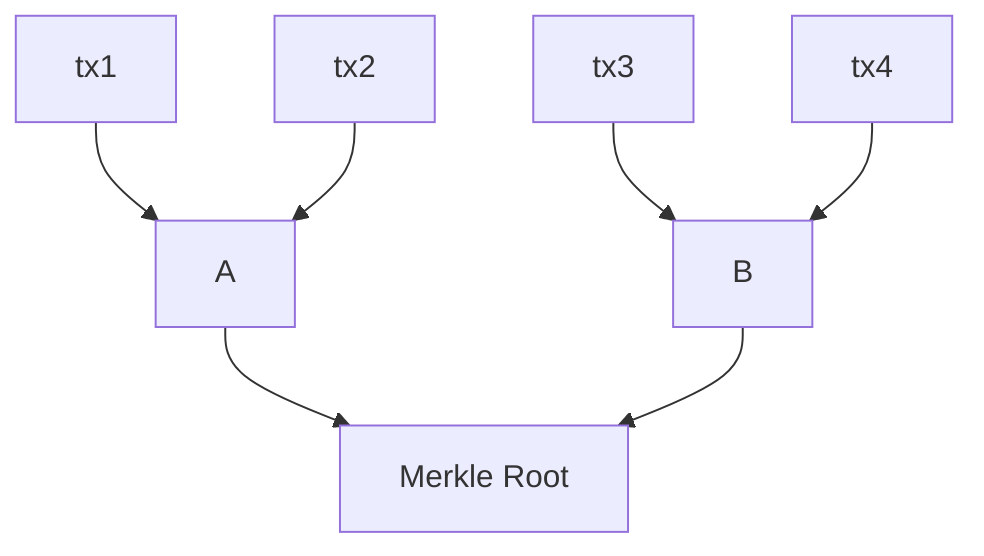
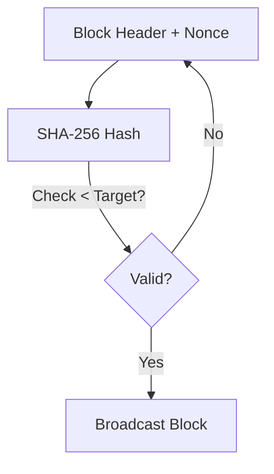

## Hook: Two Conflicting Ledgers {data-sync-id="consensus-agreement"}

- Imagine two miners publish different versions of the same block.  
- Which one is valid? Who decides?  
- Consensus must break the tie.

::: {.notes}
Key Points:
* Blockchains can diverge temporarily.  
* Consensus rules ensure eventual agreement.  
* Without consensus, trust collapses.  

Instructor Notes and Script:
Start with a visceral scenario: you open a blockchain explorer and see two versions of the chain. Which is the “real” one? This sets up the Bitcoin problem of decentralized consensus without a central arbiter.  
Explain that consensus algorithms prevent chaos, allowing nodes to eventually converge on one history. Hashes, Merkle roots, and pseudorandomness all feed into this process.  
Draw the emotional hook: confusion and mistrust if consensus fails—similar to banks giving two different balances for the same account.  

Script:  
"Picture two miners announcing different blocks. Which one do we believe? Without rules for consensus, the system breaks. Today we’ll learn how blockchain solves this."  

References:  
- [Bitcoin Whitepaper](https://nakamotoinstitute.org/bitcoin/)  
:::

## Roadmap {data-sync-unmatched="true"}

- Merkle roots in block headers  
- The “Bitcoin problem” and pseudorandomness  
- Proof-of-Work (PoW) consensus  
- Proof-of-Stake (PoS) consensus  
- Byzantine fault tolerance (BFT) concepts  

::: {.notes}
Key Points:
* Outline today’s lecture.  
* Emphasize consensus mechanisms and Merkle roots.  

Instructor Notes and Script:
Give a roadmap: how Merkle roots ensure block integrity, how consensus mechanisms resolve conflicts, and how pseudorandomness prevents predictability.  
Mention PoW, PoS, and BFT as the big families of blockchain consensus.  

Script:  
"Here’s our plan: block integrity via Merkle roots, consensus with Proof-of-Work and Proof-of-Stake, and the deeper question of Byzantine fault tolerance."  

References:  
- [Hash Functions (Intense Crypto)](https://intensecrypto.org/public/lec_07_hash_functions.html)  
:::

## Merkle Roots in Block Headers {data-sync-unmatched="true"}

::: {.column width="50%"}
- Root summarizes all transactions.  
- Included in every block header.  
- Changing one transaction changes the root.  
:::

::: {.column width="50%"}

:::

::: {.notes}
Key Points:
* Merkle roots bind all transactions into one digest.  
* Any change propagates through the root.  

Instructor Notes and Script:
Review Merkle tree mechanics briefly, then highlight their role in block headers.  
Each Bitcoin block header contains a Merkle root—if a single transaction is altered, the root changes, invalidating the block.  
This design allows fast verification and compact proofs for light clients (SPV).  

Script:  
"Merkle roots are compact receipts for all transactions. Change even one transaction, and the root changes. That’s why they anchor every block header."  

References:  
- [Merkle Trees and Verifying Storage](https://intensecrypto.org/public/lec_08_hash_functions_part2.html#merkle-trees-and-verifying-storage)  
- [Bitcoin Whitepaper](https://nakamotoinstitute.org/bitcoin/)  
:::

## The Bitcoin Problem {data-sync-id="consensus-blockchains consensus-agreement"}

- No central authority to resolve conflicts.  
- Need distributed agreement on valid chain.  
- Must resist adversarial tampering and Sybil attacks.  

::: {.notes}
Key Points:
* The core challenge: consensus without trust.  
* Bitcoin problem = decentralized double-spend resistance.  

Instructor Notes and Script:
Define the “Bitcoin problem”: how to prevent double-spending and achieve consensus without a central arbiter.  
Highlight the risk of Sybil attacks: if anyone can join, attackers may flood the network with fake identities.  
Consensus mechanisms solve this by tying block creation to scarce resources (PoW) or economic stake (PoS).  

Script:  
"The Bitcoin problem is simple to state but hard to solve: how do strangers agree on a single history of transactions without trusting anyone?"  

References:  
- [Hash Functions and the Bitcoin Problem](https://intensecrypto.org/public/lec_07_hash_functions.html#the-bitcoin-problem)  
- [Bitcoin Whitepaper](https://nakamotoinstitute.org/bitcoin/)  
:::

## Pseudorandomness in Consensus {data-sync-id="pos-selection pos-proposer ethereum-selection"}

- Randomness prevents predictability.  
- PoW: winner unpredictable until puzzle solved.  
- PoS: validator selection randomized.  

::: {.notes}
Key Points:
* Pseudorandomness keeps consensus fair.  
* Prevents adversaries from gaming block selection.  

Instructor Notes and Script:
Discuss how pseudorandom functions and generators provide unpredictability.  
In PoW, miners cannot know who will solve the puzzle first. In PoS, validator selection uses verifiable randomness to avoid bias.  
Tie back to earlier lectures: pseudorandomness is a building block for secure consensus.  

Script:  
"Consensus needs unpredictability. If we could know who wins ahead of time, attackers could cheat. Randomness keeps the system fair."  

References:  
- [PRF from PRG](https://intensecrypto.org/public/lec_05_prf-from-prg.html)  
- [Pseudorandom Generators](https://intensecrypto.org/public/lec_03_pseudorandom-generators.html)  
:::

## Proof-of-Work (Concept) {data-sync-id="consensus-nakamoto"}

- Miners solve hash puzzles (find nonce).  
- Hard to solve, easy to verify.  
- Chain with most cumulative work wins.  

::: {.notes}
Key Points:
* PoW ties block creation to computational cost.  
* Provides Sybil resistance.  

Instructor Notes and Script:
Explain that PoW forces miners to expend real resources (electricity, computation) to propose blocks.  
The puzzle: find a nonce such that block hash < target. Verification is instant once found.  
The chain with the most accumulated work is accepted by the network.  

Script:  
"Proof-of-Work makes miners prove they burned energy. The longest chain of work is the valid one."  

References:  
- [Bitcoin Whitepaper](https://nakamotoinstitute.org/bitcoin/)  
:::

## PoW Visual {data-sync-id="consensus-nakamoto"}

::: {.notes}
Key Points:
* Illustrate trial-and-error of PoW.  
* Verification is simple.  

Instructor Notes and Script:
Use the diagram to show how miners repeatedly adjust the nonce and rehash until a hash meets the target.  
Verification is trivial—any node can check the hash once. This asymmetry (hard to solve, easy to verify) is key to security.  

Script:  
"Miners keep guessing nonces until the hash is low enough. Everyone else can check instantly if it’s valid."  

References:  
- [Bitcoin Whitepaper](https://nakamotoinstitute.org/bitcoin/)  
:::

## Proof-of-Stake (Concept) {data-sync-id="pos-orientation pos-lifecycle pos-proposer"}

- Validators put stake at risk.  
- Randomly chosen to propose/attest blocks.  
- Security tied to economic penalties.  

::: {.notes}
Key Points:
* PoS replaces computation with stake.  
* Validators punished for misbehavior.  

Instructor Notes and Script:
Describe PoS: validators lock up coins as collateral. Protocol randomly selects a validator to propose blocks. Others attest.  
If they attempt double-signing or misbehavior, their stake is slashed.  
This design reduces energy use compared to PoW but introduces new economic attack models.  

Script:  
"In Proof-of-Stake, your money is your skin in the game. Cheat, and you lose your stake."  

References:  
- [Ethereum Whitepaper](https://ethereum.org/en/whitepaper/)  
:::

## Byzantine Fault Tolerance (BFT) {data-sync-id="consensus-bft"}

- Consensus must handle faulty or malicious nodes.  
- Classic bound: tolerate up to 1/3 malicious nodes.  
- Blockchain consensus adapts BFT to open networks.  

::: {.notes}
Key Points:
* Byzantine failures = arbitrary misbehavior.  
* BFT ensures progress despite bad actors.  

Instructor Notes and Script:
Introduce the concept of Byzantine faults: nodes may lie, collude, or fail arbitrarily.  
Classical BFT (e.g., PBFT) requires known participants and tolerates up to 1/3 malicious nodes.  
Blockchain consensus adapts these ideas for permissionless, open membership.  

Script:  
"Byzantine faults mean nodes might act maliciously or inconsistently. Consensus protocols ensure we can still move forward."  

References:  
- [The Byzantine Generals Problem (Lamport, Shostak, Pease, 1982)](https://lamport.azurewebsites.net/pubs/byz.pdf)  
:::

## Attacks on Consensus {data-sync-id="pos-weak-subjectivity"}

- 51% attack in PoW (majority hashpower).  
- Long-range attacks in PoS.  
- Sybil attacks in open systems.  

::: {.notes}
Key Points:
* Consensus mechanisms face distinct threats.  
* Security relies on economic/resource costs.  

Instructor Notes and Script:
Explain threats: a 51% attack in PoW lets majority control rewrite history. In PoS, long-range attacks occur if old validators collude. Sybil attacks threaten open membership unless tied to scarce resources.  
Consensus design balances these risks.  

Script:  
"No consensus is invincible. Each has attack vectors: PoW can be overpowered, PoS can be undermined by collusion. That’s why rules and incentives matter."  

References:  
- [Bitcoin Whitepaper](https://nakamotoinstitute.org/bitcoin/)  
- [Ethereum Whitepaper](https://ethereum.org/en/whitepaper/)  
:::

## Trade-offs in Consensus {data-sync-id="pos-comparison pos-orientation"}

- PoW: energy cost, strong security.  
- PoS: efficiency, new attack surfaces.  
- Choice reflects values: decentralization vs scalability.  

::: {.notes}
Key Points:
* Consensus is about trade-offs.  
* Different blockchains make different choices.  

Instructor Notes and Script:
Summarize trade-offs: PoW consumes energy but offers proven security. PoS reduces energy but depends on economic assumptions.  
Blockchains choose consensus based on values: Bitcoin prioritizes decentralization and immutability, Ethereum favors scalability and efficiency.  

Script:  
"Consensus design is about trade-offs. Do you want maximum security at high cost, or efficiency with new risks? Blockchains choose differently."  

References:  
- [Bitcoin Whitepaper](https://nakamotoinstitute.org/bitcoin/)  
- [Ethereum Whitepaper](https://ethereum.org/en/whitepaper/)  
:::

## Recap {data-sync-id="consensus-blockchains"}

- Merkle roots anchor block integrity.  
- The Bitcoin problem = decentralized consensus.  
- PoW and PoS as major solutions.  
- BFT concepts underpin blockchain design.  

::: {.notes}
Key Points:
* Consolidate lecture themes.  
* Show how pieces connect.  

Instructor Notes and Script:
Recap main lessons: Merkle roots compress data, consensus prevents divergence, pseudorandomness ensures fairness, and BFT provides fault tolerance models.  
Reinforce that all of this makes blockchains resilient in adversarial environments.  

Script:  
"If you remember one thing: consensus is how strangers agree on history without a referee. Merkle roots make tampering visible, PoW and PoS make rewriting costly."  

References:  
- [Bitcoin Whitepaper](https://nakamotoinstitute.org/bitcoin/)  
- [Hash Functions (Intense Crypto)](https://intensecrypto.org/public/lec_07_hash_functions.html)  
:::

## Check on Learning {data-sync-unmatched="true"}

- Why are Merkle roots placed in block headers?  
- What is the “Bitcoin problem”?  
- How does pseudorandomness support fairness in consensus?  
- What is the main trade-off between PoW and PoS?  

::: {.notes}
Key Points:
* Assess student grasp of consensus fundamentals.  

Instructor Notes and Script:
Use these questions to engage students. Have them explain why Merkle roots provide compact integrity proofs, why decentralized consensus is difficult, and why randomness matters.  
Ask students to compare PoW and PoS trade-offs in small groups.  

Script:  
"Pair up and explain why randomness is needed in PoS validator selection. Then debate: is PoW or PoS more secure?"  

References:  
- [Bitcoin Whitepaper](https://nakamotoinstitute.org/bitcoin/)  
- [Ethereum Whitepaper](https://ethereum.org/en/whitepaper/)  
- [PRF from PRG](https://intensecrypto.org/public/lec_05_prf-from-prg.html)  
:::
